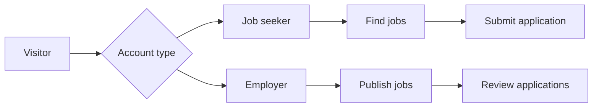

<div align="center">

# 💼 OJP — Online Job Portal

### A Django-based foundation for connecting job seekers with career opportunities.

[](https://www.python.org/)
[](https://www.djangoproject.com/)
[](https://www.sqlite.org/)
[](https://github.com/AdityaGit8009/OJP)

**[Source Code](https://github.com/AdityaGit8009/OJP)** · **[Report an Issue](https://github.com/AdityaGit8009/OJP/issues)** · **[Developer](https://github.com/AdityaGit8009)**

</div>

---

## 📖 Overview

**OJP (Online Job Portal)** is a web application project built with **Python and Django**. Its goal is to provide a central platform where candidates can discover opportunities and employers can manage recruitment activities.

The current repository contains the **initial Django project structure**, a `mainapp` application, a basic index view and template, Django admin configuration, and a local SQLite database. The full job portal functionality described in the roadmap below is **planned, not yet implemented**.

> 🚧 **Project status:** Early-stage development / foundational scaffold. This repository should not yet be treated as a complete production-ready recruitment platform.

## 🛠️ Technology Stack

| Layer | Technology | Purpose |
|---|---|---|
| Language | Python 3 | Server-side programming |
| Framework | Django 5.2 | Routing, application structure, admin and server-side rendering |
| Database | SQLite | Local development database |
| Templates | Django Templates | HTML rendering |
| Version control | Git & GitHub | Source code management |

## ✅ What Is Currently Available

- Django 5.2 project configuration (`jobportal`).
- `mainapp` Django application registered in `INSTALLED_APPS`.
- An `index` view that renders `index.html`.
- Basic template inheritance through `base.html`.
- Django's built-in admin route (`/admin/`).
- SQLite database configuration for local development.

**Important:** Job listings, accounts for employers/job seekers, applications, resume uploads and recruitment dashboards have **not been verified as implemented** in the currently available source code.

## 🗺️ Planned Features / Roadmap

| Feature | Description | Status |
|---|---|---|
| Candidate registration and login | Secure authentication for job seekers | Planned |
| Employer accounts | Employer profiles and access controls | Planned |
| Job listings | Create, browse and view opportunities | Planned |
| Search and filters | Search by title, skill, location and category | Planned |
| Job application workflow | Apply to openings and track status | Planned |
| Resume management | Upload and manage candidate resumes | Planned |
| Employer dashboard | Review applicants and manage postings | Planned |
| Candidate dashboard | Manage profile, applications and saved jobs | Planned |
| Notifications | Updates about application progress | Planned |
| Deployment hardening | Environment settings, tests and secure hosting | Planned |

## 🏗️ Project Structure

```text
OJP/
├── jobportal/             # Django project settings and URL routing
├── mainapp/               # Main Django application
│   ├── models.py          # Currently contains Django's model scaffold
│   ├── views.py           # Contains index view
│   └── templates/
│       └── index.html     # Basic page template
├── db.sqlite3             # Local SQLite database
├── manage.py              # Django management entry point
└── README.md              # Project documentation
```

*This is a simplified layout; other Django-generated files may also be present.*

## ⚙️ Getting Started

### Prerequisites

- Python 3 installed
- Git installed
- `pip` available

### 1. Clone the repository

```bash
git clone https://github.com/AdityaGit8009/OJP.git
cd OJP
```

### 2. Create and activate a virtual environment

**Windows (PowerShell):**

```powershell
python -m venv .venv
.\.venv\Scripts\Activate.ps1
```

**macOS / Linux:**

```bash
python3 -m venv .venv
source .venv/bin/activate
```

### 3. Install Django

```bash
python -m pip install "Django>=5.2,<5.3"
```

> The current repository does not expose a dependency lockfile in its root. The command above installs the Django version family indicated in the project settings.

### 4. Fix the current URL import issue

The existing `jobportal/urls.py` references `view.index` without importing `view`. Replace its relevant code with:

```python
from django.contrib import admin
from django.urls import path
from mainapp import views

urlpatterns = [
    path("admin/", admin.site.urls),
    path("", views.index, name="index"),
]
```

This adjustment is needed before starting the current project successfully.

### 5. Apply database migrations

```bash
python manage.py migrate
```

### 6. Run the development server

```bash
python manage.py runserver
```

Open **http://127.0.0.1:8000/** in your browser.

### Optional: Access the Django admin

```bash
python manage.py createsuperuser
```

Visit **http://127.0.0.1:8000/admin/** and sign in with the account you created.

> The index template currently has an empty `main` block, so the home page might display little content. A working base template and more complete UI are still needed.

## 🔁 Proposed User Journey



*Conceptual future workflow; not a description of features already implemented.*

## 🔒 Security and Production Readiness

The project currently uses development settings, including `DEBUG = True` and a hard-coded Django `SECRET_KEY`. Before deploying publicly:

1. **Rotate the exposed secret key** and load it from an environment variable.
2. Set `DEBUG = False` and configure `ALLOWED_HOSTS`.
3. Move private configuration and credentials out of source control.
4. Review whether the committed `db.sqlite3` contains any data that should not be public.
5. Add authentication, authorization, validation and automated tests.
6. Run `python manage.py check --deploy` and follow Django's deployment checklist.

**Do not deploy the repository as-is to a public production server.**

## 🤝 Contributions

Suggestions, issues and improvements are welcome. Please use [GitHub Issues](https://github.com/AdityaGit8009/OJP/issues) to report bugs or propose enhancements. If contributing code, use a feature branch and submit a pull request with a short explanation of the changes.

## 👨‍💻 Developer

**Aditya Pratap Vishwakarma**

- **GitHub:** [@AdityaGit8009](https://github.com/AdityaGit8009)
- **LinkedIn:** [Aditya Pratap Vishwakarma](https://www.linkedin.com/in/vish-aditya/)
- **Email:** [adityapratap7391@gmail.com](mailto:adityapratap7391@gmail.com)

---

<div align="center">

**Built with Python and Django · OJP is actively evolving.**

⭐ If you find this project interesting, consider starring the repository!

</div>
